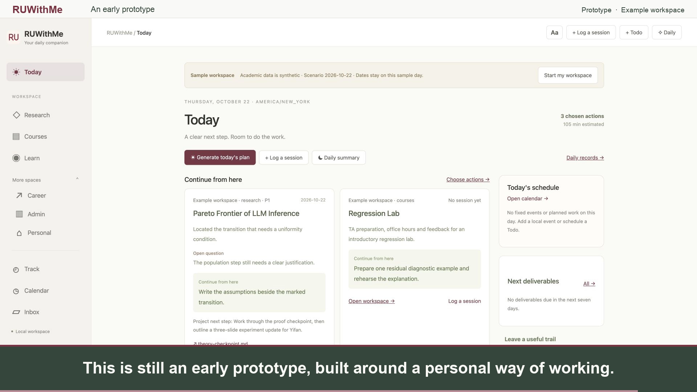

# RUWithMe

RUWithMe is an early prototype for managing everyday academic work, developed by Halo Lab, led by Professor Yifan Hu. It brings research, coursework, teaching, learning, administration, and personal tasks into one local workspace, with an AI assistant that helps you plan, keep context, and review your work.

## Watch the demo

[](docs/media/ruwithme-demo.mp4)

[Watch or download the MP4](docs/media/ruwithme-demo.mp4) · [English subtitles](docs/media/ruwithme-demo.srt)

## How it fits into a day

- **Today** brings together your schedule, upcoming deliveries, selected tasks, and recent work sessions.
- **Research, Courses, Learn, Admin, and Personal** keep materials alongside each project's context, questions, and next step.
- **Inbox** captures ideas and documents before you have time to organize them.
- **Track** keeps plans, summaries, tasks, and work history for later review.
- **Daily**, the AI assistant, can discuss a plan, summarize recorded work, and help customize the workspace.

Start with a plan, choose concrete tasks, record a session when you stop working, and review the day. Saving a session preserves what you tried, what happened, and where to continue next time. You review AI suggestions before saving plans and summaries.

## Prepare a local agent

**The AI features require an agent installed and authenticated on your computer. This version integrates with OpenAI Codex CLI.** Codex can inspect a project, edit files, and run local development tools. See the [official Codex CLI introduction](https://learn.chatgpt.com/docs/codex/cli).

Use Node.js **22.13 or newer**. macOS and Linux are recommended; this prototype has been checked on macOS.

Install Codex, then sign in with a ChatGPT account that has Codex access:

```bash
npm install -g @openai/codex@latest
codex --version
codex login
codex login status
```

Complete the browser sign-in flow. RUWithMe currently uses **ChatGPT sign-in**, rather than an API key. See [Codex authentication](https://learn.chatgpt.com/docs/auth).

## Run RUWithMe

Clone the repository and run it locally:

```bash
git clone https://github.com/HaloLab-RU/RUWithMe.git
cd RUWithMe
npm ci
npm start
```

Open **http://127.0.0.1:4191**. Installation initializes `workspace/` from the included examples without overwriting an existing workspace. Open **Daily → Check connection** to verify Codex. RUWithMe starts the local Codex app-server itself.

If the port is occupied, run `PORT=4192 npm start`. Manual tasks and files remain usable without an AI connection; AI planning and summaries need Codex.

## Files and privacy

Project materials and saved records live in your local `workspace/` folder. The published examples contain synthetic tasks and progress. They use a fixed October 23 scenario; choose **Start my workspace** to switch to real dates. Your working `workspace/` and private `.ruwithme/` runtime are excluded from Git; keep credentials and personal records out of commits.

Local storage does **not** mean fully offline AI: prompts and relevant context can be sent to OpenAI through Codex when you use the assistant. You can adapt the folder structure and application with your local agent as your needs change.
